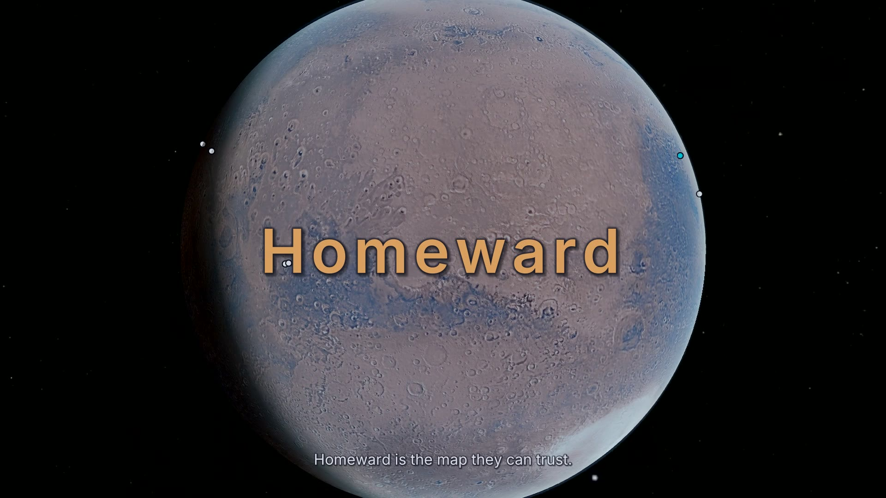
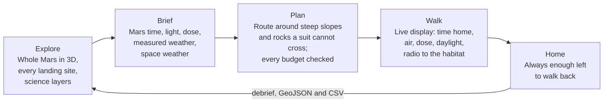
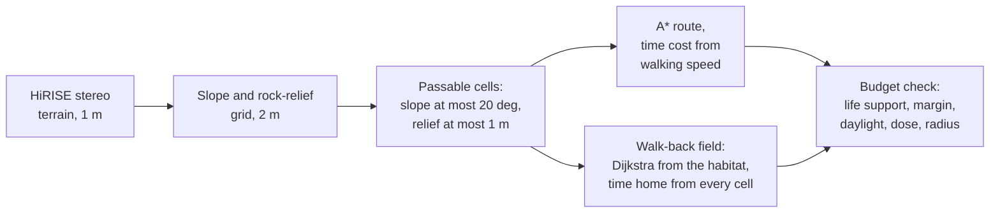
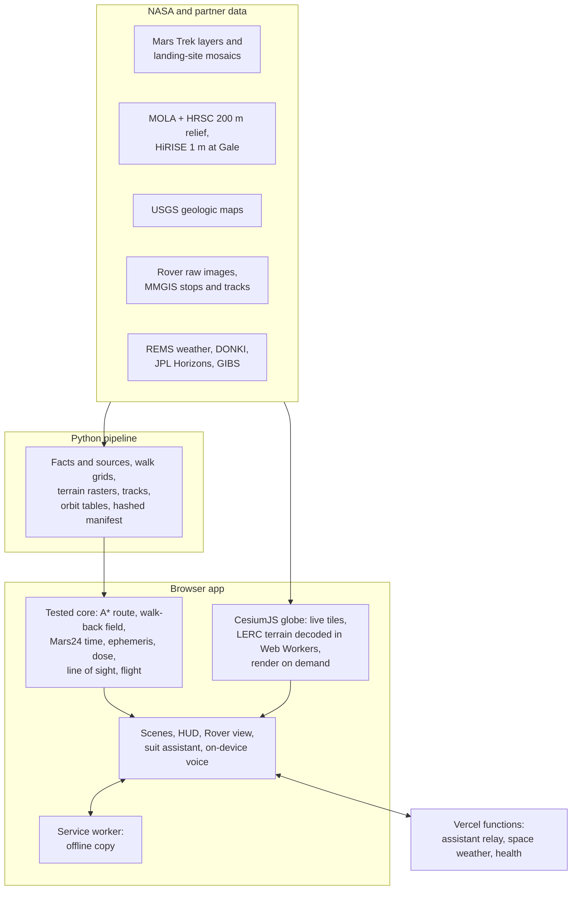

# Homeward

**A map of Mars made only from real data. It plans a Marswalk that keeps air, power, radiation dose and daylight in budget, and always gets the walker home.**

**Team Homeward** · NASA Space Apps Challenge 2026, Bengaluru · Challenge: *Interplanetary Survival Guide: Martian Map*

**Live app:** [nasa-space-app-drab.vercel.app](https://nasa-space-app-drab.vercel.app/) · **Slides (7):** [Homeward-SpaceApps2026.pptx](docs/media/Homeward-SpaceApps2026.pptx)

## Demo video

[](docs/media/homeward-30s.mp4)

**[Watch the 30-second demo (MP4)](docs/media/homeward-30s.mp4)** with English subtitles ([homeward-30s.srt](docs/media/homeward-30s.srt)). Every picture is a screen recording of the real app. The opening sound is the real wind on Mars, recorded by Perseverance's SuperCam microphone on sol 4 (NASA/JPL-Caltech/LANL/CNES).

---

## Contents

- [The problem](#the-problem)
- [What Homeward does](#what-homeward-does)
- [How it meets the challenge](#how-it-meets-the-challenge)
- [The five NASA resources, and where each lives](#the-five-nasa-resources-and-where-each-lives)
- [A tour of the product](#a-tour-of-the-product)
- [The method: how a walk is planned](#the-method-how-a-walk-is-planned)
- [A worked example: sol 182](#a-worked-example-sol-182)
- [Data layers and sources](#data-layers-and-sources)
- [Real data only](#real-data-only)
- [Architecture](#architecture)
- [Coordinates, time and physics](#coordinates-time-and-physics)
- [Performance and offline use](#performance-and-offline-use)
- [Security and privacy](#security-and-privacy)
- [API](#api)
- [Tech stack](#tech-stack)
- [Quality and testing](#quality-and-testing)
- [Run it in two minutes](#run-it-in-two-minutes)
- [Environment variables](#environment-variables)
- [Put it online](#put-it-online)
- [Repository map](#repository-map)
- [Documentation](#documentation)
- [Team](#team)
- [Credits and licences](#credits-and-licences)

---

## The problem

On Mars, help is a radio signal away: about 11 light-minutes today, so a question to Earth waits 22 minutes for its answer. A crew member who walks out from the habitat has to know, at every step, how long the walk home takes and whether air, power, radiation dose and daylight will last. A pressure suit limits how steep a slope can be climbed and which rocks can be crossed.

The data that answers this already exists: HiRISE and CTX on the Mars Reconnaissance Orbiter, THEMIS on Mars Odyssey, MOLA and TES on Mars Global Surveyor, HRSC on Mars Express, the REMS weather station and RAD radiation detector on Curiosity, the cameras of Curiosity and Perseverance, and the USGS geologic maps. But it is spread across missions, archives, formats and coordinate systems, and no map brings it together and turns it into one safe walk.

| Constraint | Value | Source |
| --- | --- | --- |
| One-way radio delay to Earth today | about 11 min (computed live) | Mars24 algorithm and JPL planetary elements |
| EVA duration limit | 8 h | NASA Exploration EVA Concept of Operations |
| Steepest slope for a suited walker | 20 deg | NASA Exploration EVA Concept of Operations |
| Early walking radius from the shelter | 2 km | NASA Exploration EVA Concept of Operations |
| Walk-back planning rate | 3.3 km/h | Apollo 17 traverse planning |
| Cosmic-ray dose at Gale | 0.64 mSv per day | Curiosity RAD (Hassler et al. 2014) |
| Horizon at 1.7 m eye height | 3.39 km | computed on Mars's 3,389.5 km radius |

## What Homeward does

It runs one loop, from the whole planet down to a single footstep:



## How it meets the challenge

| The challenge asks for | Homeward |
| --- | --- |
| A layered, integrated view of a location or route from several NASA missions | Imagery from MRO (CTX, HiRISE), Odyssey (THEMIS) and the Viking orbiters; relief from MOLA and Mars Express HRSC; overlays for geology (USGS SIM 3292), thermal inertia and dust (MGS TES), colour shaded relief and HiRISE landing-site mosaics; every layer names its source and has an opacity control |
| At least three kinds of data | Nine: optical, topographic, thermal, spectral, geologic, atmospheric (REMS), radiation (RAD), space weather (DONKI), orbital (JPL Horizons) |
| Astronaut safety first; radiation and space weather | A dose budget from Curiosity's RAD; NASA's predicted coronal mass ejections at Mars, live; a solar-storm drill during the walk that shows the time to shelter |
| Suits limit mobility; avoid obstacles such as large rocks | Slope and 1 m rock-relief cells block the route; walking speed slows on slopes; radio line of sight to the habitat over the real terrain and the planet's curvature |
| Current conditions | Mars time, the Sun, sols and the radio delay computed live; the newest sol of weather Curiosity has released, with its date; space weather live |
| Point-of-view imagery so the crew knows what to expect | Rover view: stand at any of Curiosity's 1,386 or Perseverance's 708 stops and look around in the rovers' own photos, placed where each camera pointed |
| Display as a habitat screen, tablet or helmet HUD | Desktop layout, tablet layout, and the walk's heads-up display |
| Learn from maps of other destinations | Apollo walk-back planning; Artemis EVA limits; NASA's Mars-analog field site on Earth (the Haughton-Mars Project on Devon Island) in NASA Worldview imagery |

## The five NASA resources, and where each lives

| Resource the challenge lists | Where it is in Homeward |
| --- | --- |
| JPL Mars Trek | Science overlays (geology, thermal inertia, dust, shaded relief) and landing-site mosaics: HiRISE, CTX and HRSC of Viking 1 and Viking 2, HiRISE of Jezero, Spirit, Opportunity, Phoenix and InSight. A lander's card offers "Show the site mosaic" |
| USGS-NASA Planetary Geologic Mapping Program | The rock unit under any place (from SIM 3292), and every published USGS geologic map of Mars that covers it (148 maps), finest first, with its USGS page |
| Curiosity's proposed path up Mount Sharp | NASA's 2019 route picture (PIA23179) leads Curiosity's photos, shown beside the drive Curiosity really made |
| NASA Worldview | NASA GIBS imagery of Earth's Mars-analog walking ground in the Plan scene, with Landsat or a chosen date, and the 2 km walking radius drawn to scale |
| Mars Perseverance raw images | Rover view's "Newest from Mars": the newest raw images, filtered by camera, with the published total and a step to the stop each was taken at |

## A tour of the product

| Scene | What you do there | Real data behind it |
| --- | --- | --- |
| **Mars now** | Mars Year and season, Gale's local solar time, the next sunrise and sunset in UTC and IST, Curiosity's and Perseverance's sol, and the radio delay to Earth, all live | Mars24 (NASA GISS), JPL planetary elements |
| **Explore** | A Google-Earth style globe with real 200 m relief everywhere and 1 m at Gale. Search 2,064 named places or typed coordinates; tour 13 landing sites in landing order; Curiosity and Perseverance tracks with every stop, Spirit's 7.08 km and Opportunity's 45.1 km drive paths, Ingenuity's flights; live CTX, HiRISE, THEMIS day and night or Viking colour; science overlays; the rock unit and USGS maps under any place; each lander's own photos; a ruler with an elevation profile | USGS Gazetteer, PDS Geosciences Node, MMGIS, Mars Trek, Esri OnMars, USGS, NASA Image and Video Library |
| **Orbit** | True-scale Mars lit by the real Sun, Earth's direction, Phobos, Deimos and five orbiters (MRO, Odyssey, Mars Express, TGO, Hope) at their real positions, with a time-lapse | MOLA-HRSC terrain, Viking colour, JPL Horizons |
| **Descent** | The camera flies from orbit to Bradbury Landing with Perseverance's real entry numbers; the real Mars wind fades in near the ground | Mars 2020 entry reconstruction, SuperCam microphone |
| **Briefing** | Conditions with badges, suit limits and dose; the newest weather sol from Curiosity; coronal mass ejections NASA's models predict at Mars | REMS, DONKI WSA-ENLIL, RAD, NASA EVA ConOps |
| **Plan** | Two walk zones (Yellowknife Bay, the boxwork ridges on Mount Sharp); hard budgets for life support, walk-back margin, daylight and radius; a walk-back heat map; any breach blocks approval; Earth's analog site from orbit | HiRISE DTMs, Apollo walk-back rate, Mars24, NASA GIBS |
| **Walk** | Walk it yourself at the planner's pace (slower uphill), follow the plan at 10, 30 or 60 times real time, or **Fly** anywhere at 10 to 1,000 m/s. The HUD shows time home, life support, dose, daylight, distance home, radio line of sight and the Earth delay. A dust-devil event and a solar-storm drill; a science stop with Curiosity's photos and a sample log; a debrief comparing the plan with what you did; GeoJSON and CSV export; a share link | Planner output, Perseverance's filmed dust devil, Curiosity's photos |
| **Rover view** | Street view from the rovers' own photos: Navcam and Mastcam-Z frames placed by each camera's model over the 3D view from the same spot; step along the real drive, ride it automatically, jump to a sol, open every photo with its NASA page; the newest images from Mars | NASA raw-image APIs (camera models and rover attitude), MMGIS waypoints |
| **Credits** | Every agency, dataset, licence and tool | 91 cited sources |

The **suit assistant** (bottom left) answers by voice and captions. It may only speak numbers returned by the app's own tools and names their source; without keys it uses offline rules. **Mission Control** replies after the real round-trip light time, time-compressed and labelled.

## The method: how a walk is planned



| Model | Formula | Basis |
| --- | --- | --- |
| Suited walking speed | v(s) = 3.3 × e^(−3.5·\|s + 0.05\|) / e^(−0.175) km/h, with s = rise / run | Tobler's hiking function, scaled so flat ground gives Apollo's 3.3 km/h walk-back rate; fastest is 3.93 km/h on a gentle 5% downhill |
| Way home at every step | t_elapsed(x) + T_home(x) ≤ 8 h − 30 min reserve, for every point x on the route | T_home is the walk-back field, so the margin is checked everywhere, not only at the turnaround |
| Daylight | t_return ≤ sunset − 30 min | Sunset from the Mars24 algorithm at the walk site |
| Radiation | dose = 0.64 mSv/day × time outside | Curiosity RAD at Gale |
| Radio line of sight | z_a + h_a + (z_b + h_b − z_a − h_a)·f − d(D − d)/2R − z(d) > 0 along the path | Real terrain plus the drop of the planet's curvature; suit antenna 1.7 m and habitat mast 3 m are labelled assumptions |
| Radius | straight-line distance from the shelter ≤ 2 km | NASA EVA ConOps |

Every threshold (slope, relief, reserve, daylight margin, speed factor, radius, life support) is a setting the planner exposes, with the NASA default shown.

## A worked example: sol 182

From the habitat at Bradbury Landing to Sheepbed mudstone at Yellowknife Bay, 443 m east, where Curiosity drilled on sol 182 and found the first proof of an ancient lake. The planner's own output for a start at 10:00 local solar time:

| Result | Value |
| --- | --- |
| Walk, there and back | 905 m, 17 min of walking |
| Life support used | 1 h 17 min of 7 h 30 min (8 h limit minus 30 min reserve) |
| Walk-back margin at the worst point | 6 h 13 min |
| Daylight to spare | 6 h 23 min |
| Cosmic-ray dose | 0.034 mSv |
| Radio to the habitat | in sight for the whole route |
| Verdict | GO |

## Data layers and sources

| Layer | Mission or source | Kind | Ground resolution |
| --- | --- | --- | --- |
| HiRISE orthomosaic, Gale | MRO | Optical | 25 cm |
| HiRISE stereo terrain (DTM) | MRO | Topographic | 1 m |
| Slope and rock-relief grid | derived from the HiRISE DTM | Topographic | 2 m |
| CTX global mosaic | MRO | Optical | about 5 m |
| THEMIS day and night infrared | Mars Odyssey | Thermal | 100 m |
| MOLA-HRSC blended relief, global | MGS and Mars Express | Topographic | 200 m |
| Viking colour mosaic | Viking orbiters | Optical | 232 m |
| TES thermal inertia and dust cover | Mars Global Surveyor | Thermal, spectral | about 3 km |
| Geologic map of Mars, SIM 3292 | USGS | Geologic | 1:20,000,000 |
| Landing-site mosaics (Viking 1, Viking 2, Jezero, Spirit, Opportunity, Phoenix, InSight) | MRO HiRISE and CTX, Mars Express HRSC | Optical | 25 cm to 5 m |
| REMS weather | Curiosity | Atmospheric | per sol |
| RAD dose rate | Curiosity | Radiation | per day |
| DONKI WSA-ENLIL | NASA CCMC | Space weather | per model run |
| JPL Horizons | NASA JPL | Orbital | every 10 min to 1 h |
| Raw images and stops | Curiosity, Perseverance (MMGIS) | Point of view | per frame |

## Real data only

Every number on screen comes from a cited fact in `pipeline/facts.csv`, a NASA record shown with its source, or a tested function in `app/src/core/`. Each carries a badge:

| Badge | Meaning |
| --- | --- |
| MEASURED | Measured by an instrument or recorded by a mission |
| COMPUTED | Our calculation from published inputs, tested against published values |
| STANDARD | A NASA or international standard or planning value |
| ASSUMPTION | A labelled assumption (for example the 1.7 m eye height) |
| MODELLED | A model's prediction (for example a CME arrival) |
| LIVE | Computed from the clock right now |
| GENERATED | Drawn by the app at real size and speed (for example the dust devil), never data |

There is no demo or placeholder data anywhere. Weather is always shown with its sol and date, because no rover publishes live weather.

## Architecture



Scenes never import the 3D engine directly: they call a small globe API, which keeps the startup bundle at about 150 KB gzip and loads the globe, voice and speech lazily.

## Coordinates, time and physics

- **Coordinates:** planetocentric latitude and east longitude everywhere inside the app; converted once, through one tested function, to the IAU 2015 Mars ellipsoid the 3D engine uses (the two latitudes differ by 3.21 km at Bradbury Landing). Trek and OnMars tiles are planetocentric, so they use their own tiling scheme.
- **Time:** the Mars24 algorithm (Allison and McEwen 2000) for local mean and true solar time, solar longitude, sunrise and sunset, rover sols and Mars Year; checked against NASA GISS's worked examples.
- **Light time and the Sun:** JPL's approximate planetary elements, checked against the landing light times NASA and ESA published.
- **Moons and orbiters:** JPL Horizons state vectors, interpolated with cubic Hermite splines.
- **Dose:** Curiosity RAD rates for the surface and the cruise.
- **Radio:** a straight path sampled every half cell over the HiRISE terrain, with the curvature drop d(D − d)/2R.

## Performance and offline use

- The globe renders only when something changes (idle frames drop to zero).
- Terrain tiles (LERC) are decoded in Web Workers with a least-recently-used cache, so the main thread never stalls.
- The planner runs in a Web Worker.
- The voice model (Kokoro-82M) runs on the device in a Web Worker; speech recognition uses the browser or Whisper on the device.
- After one online visit, a service worker keeps the app working offline from our own copy of the terrain, imagery and four featured rover stops.

## Security and privacy

- A strict Content Security Policy: scripts only from our origin; images and data only from named NASA, USGS, Esri and NASA GIBS hosts; no `unsafe-eval`.
- HSTS, `X-Frame-Options: DENY`, `nosniff`, a tight `Permissions-Policy`, and cross-origin isolation (`COOP same-origin`, `COEP credentialless`).
- API keys live only on the server (Vercel environment variables); the browser never sees them.
- Every outside record is validated with zod before use; a bad record is skipped, never trusted.
- Rate limits on the API; logs keep only a salted 3-byte hash of the IP address.
- No accounts and no tracking. The assistant can be switched to on-device only.

## API

| Endpoint | Method | What it does |
| --- | --- | --- |
| `/api/v1/assistant` | POST | The suit assistant relay: tries Gemini, then Groq, then OpenRouter, and falls back to offline rules; checks the origin and rate-limits |
| `/api/v1/spaceweather` | GET | NASA DONKI WSA-ENLIL runs, reduced to the CME arrivals predicted at Mars; cached 30 min |
| `/api/v1/health` | GET | Which keys are set, the allowed origins and the data manifest |

## Tech stack

| Area | Tools |
| --- | --- |
| App | Vite 8, React 19, TypeScript 7 |
| 3D | CesiumJS 1.146 (`CesiumWidget`, no Cesium ion), LERC 2.0 terrain decoding |
| Validation | zod 4 |
| Voice and speech | Kokoro-82M through kokoro-js, Whisper tiny through Transformers.js, ONNX Runtime Web |
| Icons and type | lucide-react, Inter and JetBrains Mono (self-hosted) |
| Server | Vercel functions (Node, Web Request and Response) |
| AI services for the assistant (optional, free tiers) | Google Gemini, Groq, OpenRouter |
| Data pipeline | Python 3 with NumPy and rasterio |
| Tests | Vitest 5 |
| Hosting | Vercel (free Hobby plan) |
| Demo film | FFmpeg, headless Chrome, Kokoro-82M, MusicGen |

## Quality and testing

- **84 automated tests**, including golden values against published numbers:

| Check | Published | Homeward |
| --- | --- | --- |
| Mars24 worked example | Ls 277.18758 deg (NASA GISS) | matches |
| Light time at Perseverance's landing | 11.37 min | 11.37 min |
| Light time at Curiosity's landing | 13 min 48 s (ESA) | 13.80 min |
| Phobos sub-point | 334.148 E, 0.444 N (JPL Horizons) | within 0.3 deg |
| Horizon at 1.7 m | 3.39 km | 3.39 km |
| Walk-back field on flat ground | distance / 3.3 km/h | equal |
| Curiosity's real path to Yellowknife Bay | it drove there | at least 95% walkable |

- A 40-question evaluation of the suit assistant.
- **Diagnostics** (`npm run diag`): 20 checks covering exact dependency pins, secret scanning, data hashes, fact badges and sources, colours, emoji, NASA-logo files, security headers, the dependency audit, the startup bundle size, the self-hosted models and the deployed health endpoint. The live site passes 20 of 20.

## Run it in two minutes

You need [Node.js](https://nodejs.org/) 22.12 or newer.

```bash
git clone https://github.com/rishushaurya/nasa-space-app.git
```

```bash
cd nasa-space-app
```

```bash
npm ci
```

```bash
npm run models
```

```bash
npm run dev
```

Open http://localhost:5173. `npm run models` downloads the on-device voice and speech models once (about 130 MB, pinned to a commit and hash-checked).

```bash
npm test
```

```bash
npm run diag
```

## Environment variables

All are optional; every service has a free tier and none needs a card. Copy `.env.example` to `.env.local` for local work.

| Variable | Used for |
| --- | --- |
| `GEMINI_API_KEY`, `GEMINI_MODEL` | Suit assistant, first choice |
| `GROQ_API_KEY`, `GROQ_MODEL` | Suit assistant, second choice |
| `OPENROUTER_API_KEY`, `OPENROUTER_MODEL` | Suit assistant, third choice |
| `NASA_API_KEY` | Live space weather (DONKI); without it `DEMO_KEY` is used |
| `ALLOWED_ORIGINS` | Origins allowed to call the API (your deployed URL) |
| `IP_SALT` | Salt for the hashed IP in logs and rate limits |

## Put it online

Import the repository on Vercel (Hobby, free), keep the settings in `vercel.json` (build `npm run models && npm run build`, output `dist`), add the variables above, deploy, then:

```bash
node scripts/diagnostics.mjs --base https://your-app.vercel.app
```

## Repository map

| Path | What is in it |
| --- | --- |
| `app/src/core/` | Tested logic: Mars time, ephemeris, frames, planner and its worker, dose, line of sight, moons and orbiters, places, camera models |
| `app/src/globe/` | The Cesium globe, live layers, LERC terrain and its worker |
| `app/src/scenes/` | One file per scene: Clock, Explore, Flight (Orbit and Descent), Briefing, Plan, Walk, Relive (Rover view), Credits |
| `app/src/rovers/` | Rover stops, NASA raw-image client, NASA image library |
| `app/src/data/` | Data loading and USGS lookups |
| `app/src/assistant/` | Suit assistant: tools, offline rules, voice, speech, Mission Control |
| `app/public/data/` | Generated data: facts, sources, grids, terrain, tracks, orbit tables, manifest |
| `api/` | Vercel functions |
| `pipeline/` | Python scripts that build `app/public/data/` |
| `scripts/` | Diagnostics, Cesium copy, model download |
| `film/` | The demo film: script and the pipeline that records and edits it |
| `docs/media/` | Demo video, subtitles, poster and slides |

## Documentation

| Document | What it covers |
| --- | --- |
| [Research paper](Martian%20Map%20%E2%80%94%20Space%20Apps%202026%20Research%20Paper.md) | The research the project is built on |
| [PRD.md](PRD.md) | Product requirements: users, features, priorities, acceptance |
| [TAD.md](TAD.md) | Technical architecture: components, flows, frames, caching |
| [APP_FLOW.md](APP_FLOW.md) | Scene-by-scene user journey and error recovery |
| [MENTAL_MODEL.md](MENTAL_MODEL.md) | A plain-English explanation of how the system works |
| [IMPLEMENTATION_PLAN.md](IMPLEMENTATION_PLAN.md), [FEATURE_TICKETS.md](FEATURE_TICKETS.md) | The technical specification and buildable tickets |
| [build/PLAN-2.md](build/PLAN-2.md), [PLAN-3.md](build/PLAN-3.md), [PLAN-4.md](build/PLAN-4.md) | Research findings and decisions for versions 2.0, 3.0 and 4.0 |
| [docs/DATA_SPEC.md](docs/DATA_SPEC.md) | Data files, the facts registry, tiles, provenance, licences, pipeline |
| [docs/FRONTEND_SPEC.md](docs/FRONTEND_SPEC.md) | Components, states, accessibility, performance rules |
| [docs/TESTING_STRATEGY.md](docs/TESTING_STRATEGY.md) | Golden tests, assistant evaluation, end-to-end |
| [docs/SECURITY_ACCESS.md](docs/SECURITY_ACCESS.md), [security/SECURITY_CHECKLIST.md](security/SECURITY_CHECKLIST.md) | Threat model, headers, CSP, rate limits |
| [docs/OBSERVABILITY.md](docs/OBSERVABILITY.md), [docs/SEO_PERFORMANCE.md](docs/SEO_PERFORMANCE.md) | Logs, health checks, frame rate and bundle budgets |
| [design/DESIGN_TOKENS.md](design/DESIGN_TOKENS.md) | Colours and spacing, contrast-checked |
| [legal/COMPLIANCE.md](legal/COMPLIANCE.md), [legal/PRIVACY_POLICY.md](legal/PRIVACY_POLICY.md) | Space Apps rules, data licences, privacy |
| [TEAMMATE_GUIDE.md](TEAMMATE_GUIDE.md), [COMMANDS.md](COMMANDS.md) | A plain-English guide for the team, and copy-paste commands |
| [film/SCRIPT.md](film/SCRIPT.md) | The demo film's script |

## Team

**Team Homeward**

| Member | Space Apps handle |
| --- | --- |
| Priyanshu Kumar Gupta (team owner) | `priyanshukggg19` |
| Pari Verma | `pari_1234` |
| Vanshika Tambi | `vanshikatambi` |
| Priyanshu Shaurya | `capricoter` |
| Samriddhi Tiwari | `samriddhitiwari28` |
| Iqra Chara | `iqra_04` |

## Credits and licences

Data and images: NASA, JPL-Caltech, NASA GISS, NASA CCMC, NASA GIBS and Worldview, the PDS Geosciences Node, USGS Astrogeology, the University of Arizona (HiRISE), Arizona State University (THEMIS, Mastcam-Z), Malin Space Science Systems (CTX, Mastcam), ESA, DLR and FU Berlin (HRSC), CNES and LANL (SuperCam), the Mars Institute (Haughton-Mars Project), Esri OnMars. The full list of 91 sources, with licence and credit for each, is in the app's Credits scene and in [`legal/COMPLIANCE.md`](legal/COMPLIANCE.md). No NASA logos are used, and NASA does not endorse this project.
