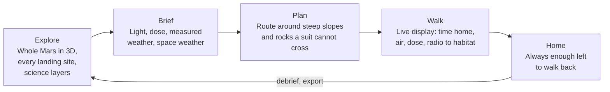
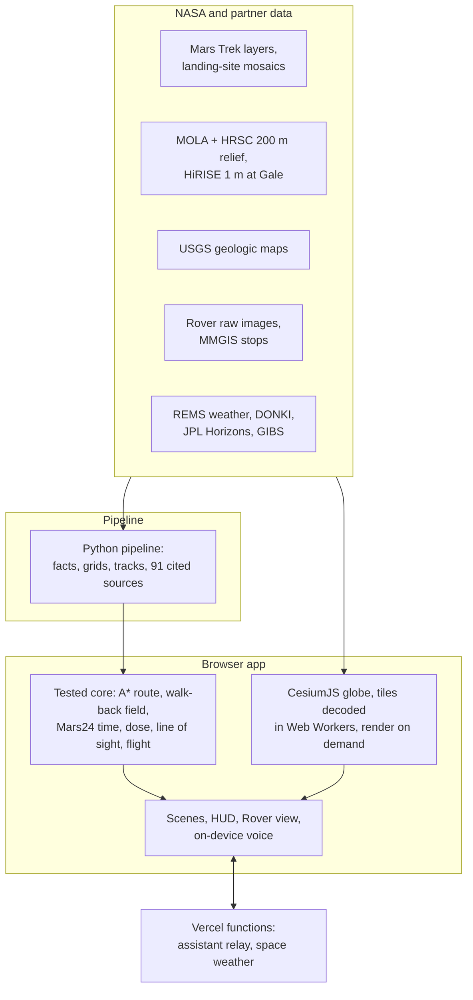

# Homeward

**A map of Mars made only from real data. It plans a Marswalk that keeps air, power, radiation dose and daylight in budget, and always gets the walker home.**

**Team Barfi** · NASA Space Apps Challenge 2026, Bengaluru · Challenge: Interplanetary Survival Guide: Martian Map

**Live:** [nasa-space-app-drab.vercel.app](https://nasa-space-app-drab.vercel.app/)

## Demo video

[](docs/media/homeward-30s.mp4)

**[Watch the 30-second demo (MP4)](docs/media/homeward-30s.mp4)**, English subtitles in [homeward-30s.srt](docs/media/homeward-30s.srt). Every picture is a screen recording of the real app. The opening sound is the real wind on Mars, recorded by Perseverance on sol 4 (NASA/JPL-Caltech/LANL/CNES). Narration is an AI voice (Kokoro-82M) and the music is AI-made (MusicGen); both are named on the end card.

---

## Contents

- [The problem](#the-problem)
- [What Homeward does](#what-homeward-does)
- [How it meets the challenge](#how-it-meets-the-challenge)
- [Run it in two minutes](#run-it-in-two-minutes)
- [A tour of the product](#a-tour-of-the-product)
- [Architecture](#architecture)
- [Real data, and where it comes from](#real-data-and-where-it-comes-from)
- [Tech stack](#tech-stack)
- [Quality and testing](#quality-and-testing)
- [Repository map](#repository-map)
- [Put it online](#put-it-online)
- [Team](#team)
- [How we built it](#how-we-built-it)

---

## The problem

On Mars, help is a radio signal away: about 11 light-minutes today, so a question to Earth waits 22 minutes for its answer. A crew member who walks out from the habitat has to know, at every step, how long the walk home takes and whether air, power, radiation dose and daylight will last. The data that answers this already exists, from HiRISE, CTX, MOLA, HRSC, THEMIS, TES, Curiosity's REMS and RAD, and more, but it is spread across missions, archives and formats, and no map brings it together for one walk.

## What Homeward does

It runs one loop, from the planet down to a single footstep:



## How it meets the challenge

| The challenge asks for | Homeward |
| --- | --- |
| A layered, integrated view of a location or route from several NASA missions | Imagery from MRO (CTX, HiRISE), Odyssey (THEMIS), Viking; relief from MOLA and Mars Express HRSC; overlays for geology (USGS SIM 3292), thermal inertia and dust (MGS TES); every layer names its source |
| At least three kinds of data | Optical, topographic, thermal, spectral, geologic, atmospheric (REMS), radiation (RAD), space weather (DONKI) |
| Astronaut safety first, radiation and space weather | Dose budget from Curiosity's RAD; NASA's predicted solar storms at Mars, live; a solar-storm drill in the walk |
| Suits limit mobility; avoid obstacles | Slope and 1 m relief cells block the route; walking speed scaled to the Apollo walk-back rate; radio line of sight to the habitat over the real terrain |
| Current conditions | Mars time, Sun, sols and radio delay computed live; the latest weather sol Curiosity has released, with its date |
| Point-of-view imagery | Rover view: stand at any of Curiosity's 1,386 or Perseverance's 708 stops and look around in their own photos |
| Learn from maps of other destinations | Apollo walk-back planning; Artemis EVA limits; NASA's Mars-analog field site on Earth in Worldview imagery |
| Habitat screen, tablet or HUD | All three: desktop, tablet layout and the walk's heads-up display |

All five resources the challenge lists are inside: **JPL Mars Trek** (layers and landing-site mosaics), the **USGS-NASA geologic maps** (rock unit and every published map at any spot), **Curiosity's proposed path up Mount Sharp**, **NASA Worldview** imagery (GIBS), and the **Perseverance raw images** (newest photos, by camera).

## Run it in two minutes

You need [Node.js](https://nodejs.org/) 22.12 or newer.

```bash
git clone https://github.com/rishushaurya/nasa-space-app.git
```

```bash
cd nasa-space-app
```

```bash
npm ci
```

```bash
npm run models
```

```bash
npm run dev
```

Open http://localhost:5173. `npm run models` downloads the on-device voice and speech models once (about 130 MB, pinned and hash-checked). No keys are needed: without them the suit assistant uses its offline rules. Copy `.env.example` to `.env.local` to add free AI keys.

## A tour of the product

| Scene | What you do there |
| --- | --- |
| **Mars now** | Mars Year, season, Gale's local solar time, sunrise and sunset, rover sols, radio delay to Earth, all live |
| **Explore** | A Google-Earth style globe: search 2,064 named places, tour 13 landing sites, Spirit and Opportunity drive paths, science overlays, the rock unit and USGS maps under any spot, each lander's own photos |
| **Orbit** | True-scale Mars lit by the real Sun, Phobos, Deimos and five orbiters at their real positions |
| **Descent** | Fly down to Gale Crater with Perseverance's real entry numbers and the real Mars wind |
| **Briefing** | Conditions, suit limits, dose, the latest measured weather, solar storms predicted at Mars |
| **Plan** | A route with hard budgets for life support, walk-back margin, daylight and radius; a walk-back heat map; Earth's analog site |
| **Walk** | Walk it yourself at the planner's pace, follow the plan, or **Fly** anywhere at 10 to 1,000 m/s; live HUD with time home and radio line of sight |
| **Rover view** | Street view from Curiosity's and Perseverance's own photos at every stop; the newest images from Mars |
| **Credits** | Every agency, dataset, licence and AI tool |

The suit assistant (bottom left) answers by voice and text, only with numbers the app's own tools return, and names the source.

## Architecture



## Real data, and where it comes from

Every number on screen comes from a cited fact (`pipeline/facts.csv`, with a badge: MEASURED, COMPUTED, STANDARD or ASSUMPTION), a NASA record shown with its source, or a tested function. There is no demo data. Sources include NASA JPL, Mars Trek, the PDS Geosciences Node, USGS Astrogeology, ESA and DLR (HRSC), Esri OnMars, the NASA Image and Video Library, NASA GIBS and JPL Horizons. The full list with licences is in the app's Credits scene and in [`legal/COMPLIANCE.md`](legal/COMPLIANCE.md).

## Tech stack

Vite, React 19, TypeScript, CesiumJS (no Cesium ion), Web Workers, LERC terrain decoding, zod at every trust boundary, Kokoro-82M voice and Whisper on the device, Python data pipeline, Vercel (free Hobby plan).

## Quality and testing

- 84 automated tests (Vitest), including golden values against published NASA numbers and a 40-question assistant evaluation.
- `npm run diag`: 20 checks, from pinned dependencies and secret scanning to the security headers and the deployed health endpoint.
- Strict Content Security Policy: only our origin and named NASA, USGS and Esri hosts.
- Works offline after one visit, from our own copy of the terrain and featured stops.

```bash
npm test
```

```bash
npm run diag
```

## Repository map

| Path | What is in it |
| --- | --- |
| `app/src/core/` | Tested logic: time, ephemeris, frames, planner, dose, line of sight |
| `app/src/globe/` | The Cesium globe, live tiles, terrain decoding |
| `app/src/scenes/` | One file per scene |
| `app/src/rovers/`, `app/src/data/` | NASA raw images, image library, USGS lookups |
| `api/v1/` | Vercel functions |
| `pipeline/` | Python scripts that build `app/public/data/` |
| `film/` | The demo film: script and the free pipeline that makes it |
| `docs/CONTEXT.md` | Full project context: rules, decisions, what is built |
| `build/` | Plans and chunk specs for each version |

## Put it online

Import the repository on Vercel (Hobby, free), keep the settings in `vercel.json`, add the variables from `.env.example`, deploy, then:

```bash
node scripts/diagnostics.mjs --base https://your-app.vercel.app
```

## Team

**Team Barfi**: Priyanshu Shaurya, Aditya Raj, Neev Pujari.

## How we built it

Code, data pipeline and documents were written with an AI coding assistant (Claude), and the build is recorded step by step in [`BUILD_LOG.md`](BUILD_LOG.md) and [`CHANGELOG.md`](CHANGELOG.md). The app's assistant uses free AI services and answers only with cited numbers. No NASA logos are used, and NASA does not endorse this project.
